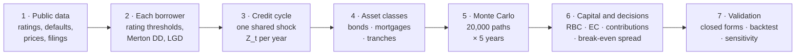
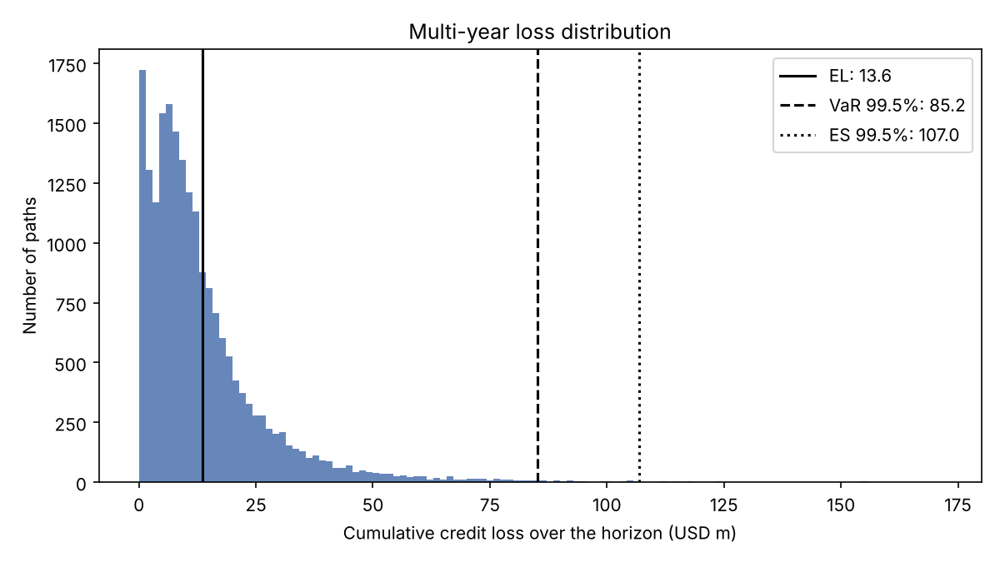
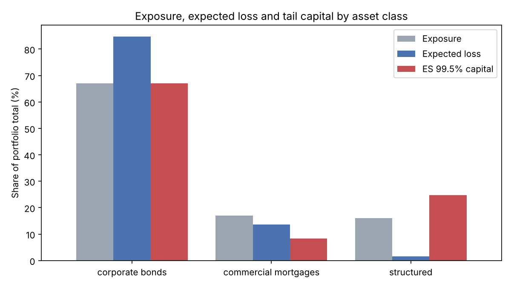
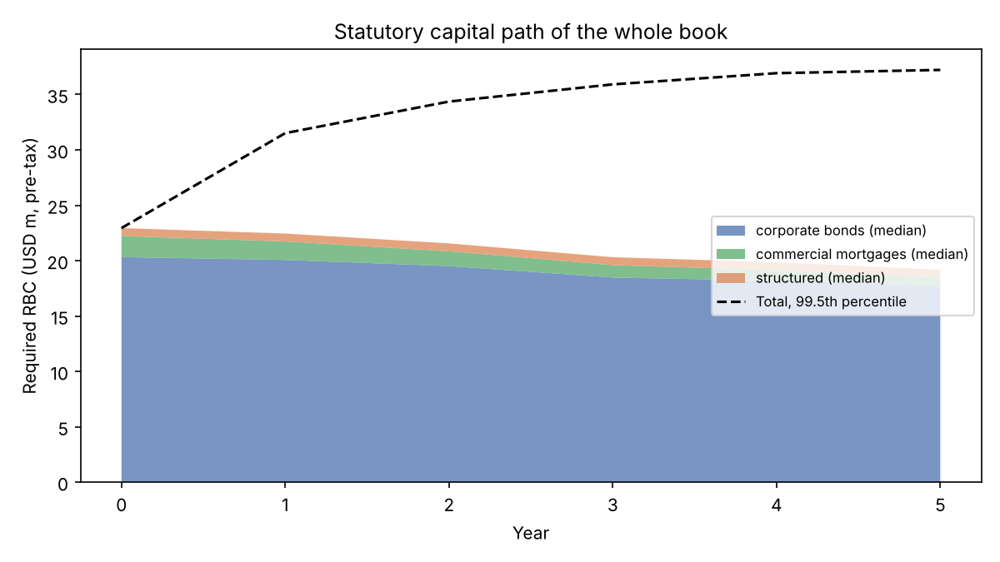
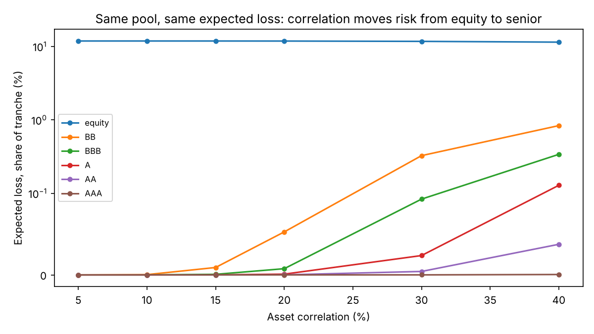
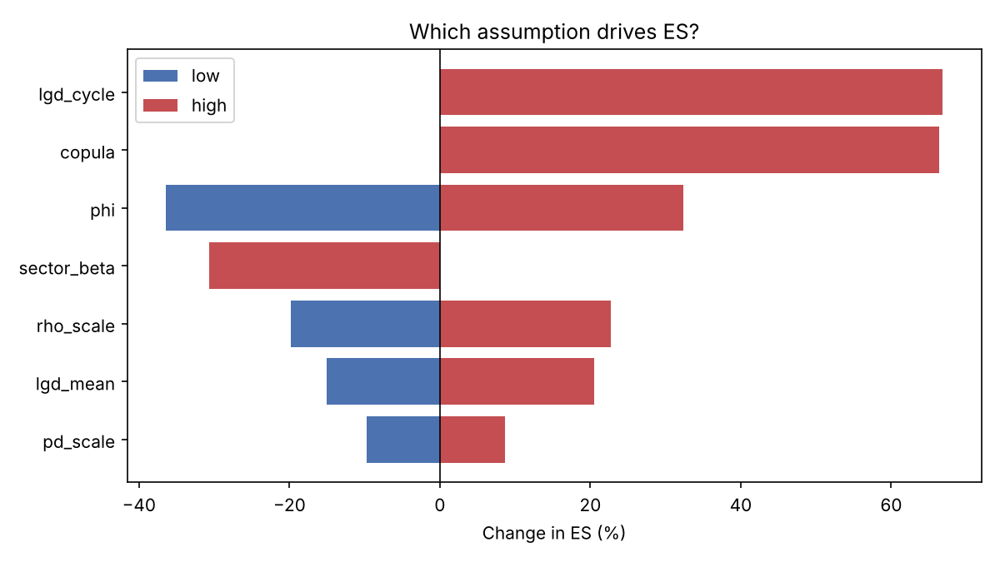
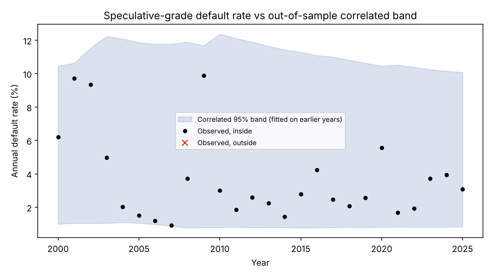
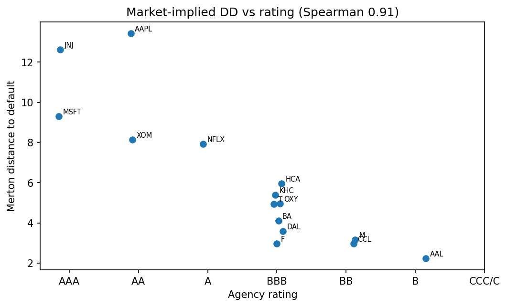

# multiyear-credit-engine

[](https://github.com/Siavash1368/multiyear-credit-engine/actions/workflows/ci.yml)

**A Merton-approach, multi-year stochastic credit risk model for an insurer's general account, built on public data.**

Corporate bonds · Commercial mortgage loans · Structured assets
Correlated default and rating migration · Credit cycles · Loss distributions · Statutory (NAIC RBC) capital · Capital allocation · Break-even spreads · Validation

> **Status: v0.2.** All three asset classes run on one simulated economy: corporate bonds (rating migration), commercial mortgages (property value and NOI, term and balloon default, CM1–CM5) and structured tranches (pool loss through attachment and detachment). Outputs: loss distribution, statutory capital path, capital contributions by asset class and sector, break-even spreads, limits and stress replays. Validated against closed forms, published default curves and an out-of-sample backtest; 94 tests. See [Status](#status).

---

## Why this project

An insurer invests annuity and policyholder money in its general account: corporate bonds, commercial mortgage loans and structured credit. Over a multi-year holding period the risk is not one borrower defaulting. It is many borrowers defaulting or being downgraded **together** in a bad credit cycle, which raises both realised losses and statutory capital charges.

The engine answers four questions for a credit portfolio:

1. **How much could we lose?** The multi-year loss distribution: expected loss, VaR and expected shortfall.
2. **How much capital does it use?** The NAIC risk-based capital path, year by year, as ratings and loan metrics migrate.
3. **Who causes the risk?** Each asset's, sector's and asset class's contribution to tail capital; contributions add up to the total.
4. **Is the spread worth it?** The break-even spread that pays for expected loss plus the cost of capital, against the market spread.

## Key terms

| Term | Meaning |
|---|---|
| **PD** | Probability of default: chance a borrower defaults within a year |
| **LGD** | Loss given default: share of the exposure lost if the borrower defaults |
| **EAD** | Exposure at default: amount owed at the time of default |
| **EL** | Expected loss: the average loss across all simulated paths |
| **VaR 99.5%** | Value at risk: the loss exceeded in only 0.5% of paths (1 year in 200) |
| **ES 99.5%** | Expected shortfall: the average loss in that worst 0.5% of paths |
| **EC** | Economic capital = ES − EL: the cushion needed above the average loss |
| **NAIC RBC** | Risk-based capital: the US statutory capital charge for an insurer's assets |
| **NAIC designation** | Statutory credit grade of a bond (1.A best … 6 in default), mapped from its rating |
| **CM1–CM7** | NAIC categories for commercial mortgages, set by DSCR and LTV (CM1 best) |
| **DSCR** | Debt service coverage ratio = property income (NOI) ÷ annual loan payment |
| **LTV** | Loan to value = loan balance ÷ property value |
| **NOI** | Net operating income of a property |
| **OAS** | Option-adjusted spread: the market's extra yield over Treasuries |
| **DD** | Distance to default: standard deviations between a firm's assets and its debt |

## How the model works

**One simulated economy drives every asset.** Each simulated year draws one credit-cycle shock shared by all borrowers. Each borrower's outcome — keep its rating, be downgraded, or default — depends on that shared shock plus its own luck. Losses are added up over 20,000 simulated five-year paths; that loss distribution then drives capital, contributions and pricing.



### 1. Borrower — Merton distance to default (listed issuers)

*How close is a firm to default, judged by its stock market value?* (NB02)

Equity is a call option on the firm's assets: shareholders get what is left after the debt is paid.

$$E = V\,N(d_1) - D\,e^{-rT}N(d_2), \qquad \sigma_E\,E = N(d_1)\,\sigma_V\,V$$

We see $E$, $\sigma_E$, $D$ and $r$; we solve these two equations for the two unknowns $V$ and $\sigma_V$.

$$DD = \frac{\ln(V/D) + (\mu - \tfrac12\sigma_V^2)\,T}{\sigma_V\sqrt{T}}, \qquad PD = N(-DD)$$

How many standard deviations the assets sit above the debt after one year, and the chance they fall below it.

| Symbol | Meaning |
|---|---|
| $V,\ \sigma_V$ | Market value of the firm's assets and its annual volatility — not observed, solved for |
| $E,\ \sigma_E$ | Market value of equity (price × shares) and its annual volatility from daily returns |
| $D$ | Default point = current liabilities + ½ long-term liabilities (KMV rule) |
| $r,\ \mu$ | 1-year Treasury rate; asset growth rate, set to $r$ |
| $T$ | Horizon, 1 year |
| $N(\cdot)$ | Standard normal probability; $d_1, d_2$ are the Black–Scholes terms |

*Example:* Ford — assets USD 217bn, asset volatility 8.4%, default point USD 176bn → DD 2.97, PD 0.15%.
*Used for* ranking and early warning; PD levels come from rating-agency history (L-11).

### 2. Borrower — rating migration thresholds

*Given a rating today, how does the simulation decide next year's rating?* (NB04)

$$c_{k,j} = \Phi^{-1}\Big(\sum_{l \ge j} m_{k,l}\Big)$$

Cut a standard normal into one bin per rating, sized so each bin's probability equals the historical chance of moving to that rating.

$$\text{next rating} = j \quad \text{when} \quad c_{k,j+1} < A_{i,t} \le c_{k,j}$$

The borrower lands in the bin where its asset return falls.

| Symbol | Meaning |
|---|---|
| $k$ | Borrower's rating today |
| $j,\ l$ | Possible ratings next year, ordered AAA (best) … CCC/C, D (default, worst) |
| $m_{k,l}$ | Historical one-year probability of moving from $k$ to $l$ (S&P transition matrix) |
| $\sum_{l \ge j} m_{k,l}$ | Probability of ending at rating $j$ **or worse** |
| $\Phi^{-1}$ | Inverse standard normal: turns a probability into a cut-off |
| $c_{k,j}$ | Cut-off: below it, the borrower ends at $j$ or worse |
| $A_{i,t}$ | Borrower $i$'s asset return in year $t$ (section 3) |

**Which one moves?** The cut-offs are fixed by history. The asset return $A_{i,t}$ moves every year. A bad year pushes $A$ down for everyone at once, so more borrowers drop through the lower cut-offs together.
*Example:* a BBB issuer's one-year default rate is 0.14%, so its default cut-off is $\Phi^{-1}(0.0014) = -2.99$: it defaults when $A < -2.99$.

### 3. Credit cycle — the shared shock

*Why do defaults cluster?* (NB03)

$$A_{i,t} = \sqrt{\rho}\,Z_t + \sqrt{1-\rho}\,\varepsilon_{i,t}$$

Each borrower's asset return = shared economy part + its own part.

$$Z_t = \phi\,Z_{t-1} + \sqrt{1-\phi^2}\,\eta_t$$

The economy is persistent: a bad year tends to be followed by another bad year.

$$PD(Z_t) = \Phi\!\left(\frac{\Phi^{-1}(PD) - \sqrt{\rho}\,Z_t}{\sqrt{1-\rho}}\right)$$

Default probability in a given year depends on the state of the economy.

| Symbol | Meaning |
|---|---|
| $Z_t$ | Credit-cycle shock in year $t$, shared by all borrowers (low = bad year) |
| $\varepsilon_{i,t}$ | Borrower $i$'s own shock, independent of everyone else |
| $\rho$ | Asset correlation: how much each borrower depends on the economy (Basel formula by PD) |
| $\phi$ | Persistence of the cycle (0 = years independent, 0.5 used here) |
| $\eta_t$ | New economy shock each year |
| $\beta$ | Share of a sector or asset-class factor that is the global cycle: $Z_k = \sqrt{\beta}\,G + \sqrt{1-\beta}\,H_k$ |

*Example:* BBB, average PD 0.14%, $\rho = 0.20$ → PD 0.04% in an average year ($Z=0$) but 0.95% in a bad year ($Z=-2$), about 24 times higher.
*Option:* a Student-t copula adds a common "panic" factor that makes joint extreme years more likely.

### 4. Asset classes on the same economy

**Bonds** (NB06) — each year, every bond migrates by section 2; on default, loss = EAD × LGD, with LGD drawn from a beta distribution (mean 60%), optionally worse in bad years (NB05).

**Commercial mortgages — Merton on the building** (NB07)

Property value $V_t$ and income $NOI_t$ follow random paths driven by the commercial real estate cycle (half the global cycle, $\beta = 0.5$).

$$\text{term default: } DSCR_t < 1 \ \text{and}\ LTV_t > 1 \qquad \text{balloon default: refinancing fails at maturity}$$

The borrower cannot pay from income **and** has no equity left to sell; or cannot refinance the final balance.

$$LGD = \frac{\max\big(B - (1-\kappa)V,\ 0\big)}{B}$$

Loss is the part of the loan not covered by selling the building.

| Symbol | Meaning |
|---|---|
| $B$ | Loan balance at default |
| $V$ | Property value at default |
| $\kappa$ | Selling and foreclosure costs as a share of value |

*Example:* balance 70, value 60, costs 10% → sale proceeds 54, loss 16, LGD 23%.

**Structured tranches** (NB08) — the collateral pool is simulated with the same engine; the contract slices the pool loss.

$$\ell_{[a,d]} = \frac{(L - a)^+ - (L - d)^+}{d - a}$$

A tranche loses nothing until pool losses pass $a$, and is wiped out once they pass $d$.

| Symbol | Meaning |
|---|---|
| $L$ | Pool loss rate (share of the pool lost) |
| $a,\ d$ | Attachment and detachment points: where the tranche starts and stops taking loss |
| $(x)^+$ | $\max(x, 0)$ |

*Example:* 3–7% tranche, pool loss 6% → (6 − 3)/(7 − 3) = 75% of the tranche lost.

### 5. Monte Carlo

For each of 20,000 paths and each of 5 years: draw $Z_t$ → draw each borrower's $A_{i,t}$ → migrate or default every bond, update every mortgage and the tranche pools → add up the losses. The 20,000 path totals form the loss distribution (EL, VaR, ES).

### 6. Capital and decisions (NB09)

$$RC_i = E[L_i \mid L \ge VaR_{99.5\%}] - E[L_i], \qquad \sum_i RC_i = EC$$

An asset's share of capital = its average loss in the worst 0.5% of paths minus its normal average loss. Shares add up exactly to the total.

$$s^* = EL + k \times \text{RBC factor} \times CoC$$

The spread an asset must earn to pay for its expected loss plus the cost of the capital it ties up.

| Symbol | Meaning |
|---|---|
| $L_i,\ L$ | Loss of asset $i$; loss of the whole book |
| $RC_i$ | Risk contribution of asset $i$ |
| $s^*$ | Break-even spread per year |
| $EL$ | Annual expected loss |
| RBC factor | NAIC capital charge per unit of exposure for that rating |
| $k$ | Capital held as a multiple of the RBC charge (2) |
| $CoC$ | Cost of capital: return shareholders require (10%) |

*Example:* BBB → expected loss 16 bp + capital cost (2 × RBC factor × 10%) 33 bp = break-even 49 bp, against a market spread of 102 bp: a 53 bp cushion.

### 7. Validation (NB10)

Each piece is checked against something independent: the Vasicek large-pool formula (a closed form for the default fraction of a large one-factor portfolio), published cumulative default curves, an out-of-sample backtest of 2000–2025 default rates, convergence of the tail estimate, and one-at-a-time sensitivity of ES to every key assumption.

## Results

Every number below is produced by a script (`python scripts/make_report.py`); the full tables are written to `reports/summary.md` and `reports/validation_summary.md`.

### 1. Corporate bond book (v0.1 benchmark)

Stylised USD 1bn bond book, 200 issuers, 77% A/BBB. Five years, 20,000 paths, ρ by the Basel formula, φ = 0.5, beta LGD with mean 60%. (`scripts/run_simulation.py`)

| Five-year cumulative loss | USD m | % of book |
|---|---|---|
| Expected loss | 13.6 | 1.36% |
| VaR 99.5% | 85.2 | 8.52% |
| Expected shortfall 99.5% | 107.0 (± 3.0 bootstrap s.e.) | 10.70% |

Required C-1 bond RBC: USD 30.3m at year 0; at year 5, median 26.5m and 99.5th percentile 53.2m. The median falls as bonds mature (static book); in bad paths it rises as survivors are downgraded.



### 2. The whole book on one economy (v0.2)

Stylised USD 1bn general-account credit book with a mix close to a large life insurer's public statutory disclosure: corporate bonds 67%, commercial mortgages 17% (apartment-heavy, average DSCR ≈ 2.0, LTV ≈ 60%, weaker office loans), structured 16% (senior tranches of a leveraged-loan pool). The commercial real estate cycle is half the global credit cycle (β = 0.5). (`scripts/run_portfolio.py`)

| Five-year loss, USD m | Corporate bonds | Commercial mortgages | Structured | **Whole book** |
|---|---|---|---|---|
| Expected loss | 9.2 | 1.5 | 0.2 | **10.8** |
| VaR 99.5% | 59.1 | 13.2 | 13.0 | **76.6** |
| ES 99.5% | 74.8 | 16.1 | 25.3 | **106.0** |
| Economic capital (ES − EL) | 65.7 | 14.7 | 25.2 | **95.2** |

Diversification across asset classes reduces economic capital by **9.8%** against the sum of the stand-alone figures.

**Who causes the risk.** Contributions add up exactly to the book's economic capital.

| Asset class | Exposure | Expected loss | **ES 99.5% capital** | Statutory RBC (year 0) |
|---|---|---|---|---|
| Corporate bonds | 67% | 85% | **67%** | USD 20.3m |
| Commercial mortgages | 17% | 14% | **8%** | USD 1.9m |
| Structured | 16% | 2% | **25%** | USD 0.7m |



- **Expected loss and tail capital point at different assets.** Structured tranches are 2% of expected loss but 25% of tail capital, while carrying only 3% of statutory RBC. The A tranche alone is 2% of exposure and 17% of tail capital: a senior tranche is quiet in normal years and loses only in the joint tail.
- **In the bond book, BBB drives the tail.** BBB is 30% of the book and 36% of tail capital; CCC is under 1% of the book, 24% of expected loss and 1% of tail capital. The tail is driven by what is big and correlated, not by what is weak.
- **Limits on capital, not exposure.** With illustrative limits of 70/15/15% of economic capital, structured uses 165% of its limit, corporates 96%, mortgages 55%.
- **Stress replay.** Re-running years 2000–2004 of the implied credit cycle as the global path more than doubles the five-year loss (USD 23.4m vs 10.8m).



**Is the spread worth it?** Break-even spread = annual expected loss + 2 × RBC factor × 10% cost of capital, against the ICE BofA option-adjusted spread on the latest date available:

| Rating | Expected loss | Capital cost | Break-even | Market OAS | Cushion |
|---|---|---|---|---|---|
| A | 5 bp | 20 bp | 25 bp | 69 bp | +44 bp |
| BBB | 16 bp | 33 bp | 49 bp | 102 bp | +53 bp |
| BB | 69 bp | 93 bp | 162 bp | 194 bp | +32 bp |
| B | 197 bp | 166 bp | 363 bp | 315 bp | **−48 bp** |

At current spreads, single-B does not pay for its expected loss and capital; BBB clears with the widest cushion.

**Structured: correlation moves risk from equity to senior.** For the same pool and the same expected loss, raising asset correlation lowers expected loss on the equity piece and raises it on every senior tranche.



### 3. Validation highlights

| Check | Result |
|---|---|
| Engine vs Vasicek closed form (V-01) | 99.5% default fraction 18.1% simulated vs 18.0% analytical |
| Simulation with no cycle vs matrix powers (V-03) | equal within Monte Carlo error |
| Out-of-sample backtest, 2000–2025 (V-05) | speculative-grade default rate inside the correlated 95% band in 26 of 26 years; an independent (binomial) band for a cohort of 500 issuers (illustrative) would reject in 14 of 26. Single-B: 3 of 26 outside. BB: 7 of 26 outside, 5 of them zero-default years (L-10) |
| Implied cycle vs public data | correlation −0.64 with the bank charge-off rate on business loans (FRED) |
| Convergence (V-07) | ES 99.5% bootstrap standard error USD 3.0m at 20,000 paths |
| Importance sampling | standard error of a far-tail probability cut by a factor of 6.8 |
| Mortgage balloon default vs Merton closed form | 7.82% simulated vs 7.81% |
| Tranche expected loss vs large-pool formula (V-10) | e.g. 3–7% tranche 4.00% vs 4.05% |
| CM category mapping vs NAIC grid (V-12) | 14 grid cells tested |

**Which assumption drives the tail?** One-at-a-time sensitivity of the bond book's ES 99.5% (`scripts/run_validation.py`):



Model-form choices move the tail more than parameter levels: a Student-t copula (ν = 6) or recovery linked to the cycle each raise ES by about two thirds, cycle persistence moves it by about a third, sector diversification (β = 0.5) lowers it by about 30%, while ±20% on PD moves it by under 10%. These are reported, not hidden: they are the limitations a model owner has to manage.



### 4. Merton on listed issuers

Distance to default for 15 listed issuers from equity prices and SEC filings (asset value and volatility backed out of equity; KMV default point). (`scripts/run_merton.py`)



Merton ranks issuers in line with agency ratings (Spearman 0.90). Raw $N(-DD)$ is far below historical default rates for investment-grade names because the normal tail is too thin, so DD is used for ranking and early warning and mapped to observed default rates for levels (L-11). Ford has the lowest DD among BBB names because its captive finance arm's liabilities sit on the consolidated balance sheet, a known Merton blind spot. The full step-by-step build is in [NB02](notebooks/02_merton_structural_model.ipynb) (Spearman 0.91 there, after correcting a stale SEC share count).

## Repository structure

```
multiyear-credit-engine/
├── configs/                 # Model, portfolio, scenario and capital-factor configuration (YAML)
├── data/
│   ├── raw/                 # Source data exactly as downloaded (see data/raw/MANIFEST.md)
│   ├── interim/             # Annual cycle panel built by scripts/build_interim.py
│   ├── processed/           # Model-ready inputs and calibrated parameters
│   └── external/            # Reference tables entered by hand, with citations
├── docs/                    # Model documentation: scope, assumptions, limitations, validation, methodology
├── notebooks/               # Research notebooks, one per model component (NB01–NB12)
├── reports/                 # Generated figures, tables and summaries
├── scripts/                 # Command-line entry points
├── src/creditengine/        # The engine: installable Python package
└── tests/                   # Unit and integration tests (pytest)
```

## Notebooks

Each notebook builds one component from scratch, cell by cell, on the same public data, so every step of the engine can be read and rerun. Its functions are then kept in `src/creditengine/` with tests. **NB02 (Merton) is complete**; the others hold the outline, theory and checklist and are being filled in one by one.

| NB | Notebook | Component | Engine module |
|---|---|---|---|
| 01 | [Data foundation](notebooks/01_data_foundation.ipynb) | Transition matrices, default history, macro series, RBC factors | `data` |
| 02 | [Merton structural model](notebooks/02_merton_structural_model.ipynb) | Asset value and volatility from equity; distance to default | `models.merton`, `data.edgar` |
| 03 | [Credit cycle](notebooks/03_credit_cycle.ipynb) | Implied factor; fit of ρ and φ; scenarios | `models.cycle` |
| 04 | [Rating migration](notebooks/04_rating_migration.ipynb) | Thresholds, matrix powers, generators, cycle-conditional matrices | `models.migration` |
| 05 | [Recovery and LGD](notebooks/05_recovery_lgd.ipynb) | Beta LGD; recovery linked to the cycle | `models.recovery` |
| 06 | [Corporate bond portfolio](notebooks/06_corporate_bond_portfolio_mc.ipynb) | Multi-year Monte Carlo; copulas; variance reduction | `simulation`, `assets.corporate` |
| 07 | [Commercial mortgage loans](notebooks/07_commercial_mortgage_loans.ipynb) | Property value and NOI paths; term and balloon default; CM categories | `assets.cre` |
| 08 | [Structured assets](notebooks/08_structured_assets.ipynb) | Pool loss to tranche loss; thickness; correlation | `assets.structured` |
| 09 | [Capital, pricing and limits](notebooks/09_capital_pricing_limits.ipynb) | RBC path; contributions; break-even spread; limits | `capital` |
| 10 | [Model validation](notebooks/10_model_validation.ipynb) | Closed form, backtests, sensitivity, convergence | `validation` |
| 11 | [Assumptions, outputs and reporting](notebooks/11_assumptions_outputs_reporting.ipynb) | Assumption-to-output attribution; executive summary | `reporting` |
| 12 | [ML challenger (optional)](notebooks/12_ml_challenger_optional.ipynb) | Machine-learning PD challenger vs Merton | `models.challenger` |

## Data

All data is public. Nothing proprietary or employer-specific is used. Full source list: [`data/README.md`](data/README.md) and [`data/raw/MANIFEST.md`](data/raw/MANIFEST.md).

| Source | Used for |
|---|---|
| Rating-agency annual default and transition studies (S&P) | Transition matrix, default history, cumulative default curves |
| FRED (Federal Reserve Bank of St. Louis) | Credit-cycle proxies, spreads, rates, CRE delinquency and charge-offs |
| SEC EDGAR (XBRL company facts) and daily equity prices | Merton inputs for listed issuers |
| NAIC Life RBC instructions; American Academy of Actuaries | Bond designation factors, CM1–CM7 grid and factors |

Licensed or provider-restricted files (S&P tables, ICE BofA spread series, equity prices, SEC downloads) are kept out of Git; see `.gitignore` and [`data/external/README.md`](data/external/README.md). Without them the tests that need them are skipped and everything else runs.

## Getting started

```bash
git clone https://github.com/Siavash1368/multiyear-credit-engine.git
cd multiyear-credit-engine
python -m venv .venv
.venv\Scripts\activate            # Windows  (macOS/Linux: source .venv/bin/activate)
pip install -r requirements.txt
pip install -r requirements-dev.txt
pip install -e .
cp .env.example .env              # add your FRED API key and SEC user agent
```

Run the tests and the pipeline:

```bash
pytest                                   # 94 tests; S&P-dependent tests skip if the tables are absent
python scripts/download_fred.py          # public FRED series
python scripts/make_report.py            # calibrate -> bond book -> whole book -> validation
python scripts/run_merton.py             # Merton DD for listed issuers (needs prices and SEC files)
```

| Script | Output |
|---|---|
| `calibrate.py` | (PD, ρ) by rating, implied cycle Z_t, persistence φ |
| `run_simulation.py` | Bond book: losses, RBC path, Vasicek and cumulative-PD checks |
| `run_portfolio.py` | Whole book: losses, contributions, capital path, tranches, pricing, limits, stress |
| `run_validation.py` | Backtest, cycle proxies, convergence, importance sampling, tornado, closed-form checks |
| `run_merton.py` | Distance to default for listed issuers vs ratings |
| `build_interim.py` | Annual credit-cycle panel in `data/interim/` |

## Status

| Engine | Module | Status | Tests |
|---|---|---|---|
| Data: S&P tables, NAIC factors, FRED, SEC company facts | `data.*` | ✅ | `test_data.py`, `test_validation_extra.py` |
| Merton: distance to default, asset value from equity, listed issuers | `models.merton`, `data.edgar` | ✅ | `test_merton.py` |
| Credit cycle: conditional PD, implied factor, ρ and φ fit, AR(1) paths, sector factors | `models.cycle`, `simulation.sampling` | ✅ | `test_cycle.py`, `test_sampling.py` |
| Rating migration: thresholds, conditional matrices, $P^n$, generator | `models.migration` | ✅ | `test_migration.py` |
| Recovery: beta LGD; LGD linked to the cycle | `models.recovery` | ✅ | `test_recovery.py` |
| Bond Monte Carlo: Gaussian or Student-t copula, sectors, antithetic paths | `simulation.engine` | ✅ | `test_simulation.py` |
| Commercial mortgages: value and NOI paths, term and balloon default, CM1–CM5 | `assets.cre` | ✅ | `test_cre.py` |
| Structured: tranche losses on a simulated pool, closed form, correlation sensitivity | `assets.structured` | ✅ | `test_structured.py` |
| Whole book on one economy | `simulation.portfolio`, `assets.book` | ✅ | `test_whole_book.py` |
| Capital: RBC path, ES and σ contributions, break-even spread, limits, risk transfer | `capital.*` | ✅ | `test_capital.py`, `test_allocation.py` |
| Validation: closed forms, walk-forward backtest, convergence, importance sampling, tornado | `validation.*` | ✅ | `test_validation*.py` |
| Interest waterfall and coverage tests for structured deals | `assets.structured` | ⬜ Planned (L-09) | |
| Through-the-cycle matrix calibration; reinvestment; NAIC 6 workout capital | `models.migration`, `simulation` | ⬜ Planned (L-01, L-06, L-07) | |
| Worked research notebooks NB01–NB12 | `notebooks/` | ◐ NB02 complete; others being filled in | |
| ML PD challenger | `models.challenger` | ⬜ Optional | |

Roadmap: [`docs/roadmap.md`](docs/roadmap.md).

## Model documentation

| Document | Purpose |
|---|---|
| [Model scope](docs/model_scope.md) | Purpose, intended use, in and out of scope, outputs |
| [Assumption register](docs/assumption_register.md) | Every assumption with an ID, value, source and sensitivity |
| [Limitations](docs/limitations.md) | Known limitations, impact and mitigation |
| [Validation plan](docs/validation_plan.md) | Tests, acceptance criteria and results |
| [Methodology](docs/methodology/) | One note per component, with equations |
| [Data dictionary](docs/data_dictionary.md) | Every dataset and field |
| [References](docs/references.md) | Books, papers and regulatory documents |

## References

Core text: Bluhm, Overbeck and Wagner, *Introduction to Credit Risk Modeling*, 2nd ed., Chapman & Hall/CRC, 2010. Full list in [`docs/references.md`](docs/references.md).

## Disclaimer

This is an independent research project built on public data for educational purposes. Portfolios are stylised; they do not use, represent or describe the models, data, holdings or practices of any employer or company. Capital factors are taken from public NAIC and Academy documents and must be checked against current official instructions before any real use.

## License

[MIT](LICENSE) © 2026 Siavash Feizi
